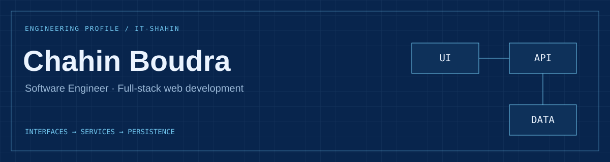
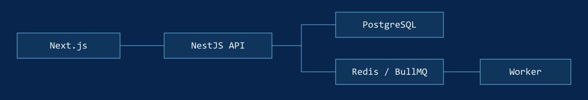

**Chahin Boudra / Tangier, Morocco**  
Full-stack web development across interfaces, services, and persistent data.

&nbsp; 

## System in focus: OpsDesk

A multi-tenant support inbox and CRM built with a separate frontend, API, and background worker.

Illustrative data flow · <a href="./assets/architecture.svg">View static diagram</a>

| Boundary | Implementation to inspect |
| :--- | :--- |
| **Identity → data** | Auth0 sessions, organization membership, role checks, and tenant-scoped queries. |
| **Request → background job** | BullMQ email processing, retry behavior, and webhook deduplication. |
| **API → browser** | Authorized Socket.IO rooms and reconnect recovery. |
| **Code → verification** | Integration tests, GitHub Actions, Docker builds, and OpenAPI. |

[Case study](https://github.com/It-shahin/opsdesk/blob/master/docs/PORTFOLIO.md) · [Repository](https://github.com/It-shahin/opsdesk)

OpsDesk is a staging portfolio project. The case study is public; hosted access requires an authorized account.

## Related systems

**[Project Management](https://github.com/It-shahin/Project-Management-App)** — Next.js client → Express API → PostgreSQL. Board, list, and timeline task planning.

**[Collaborative Docs](https://github.com/It-shahin/GDocs-clone)** — Next.js + Convex + Liveblocks + TipTap. Google Docs-inspired editing and document workspaces.

**[Property Booking](https://github.com/It-shahin/airbnb-clone)** — Next.js + Prisma + MongoDB. Airbnb-inspired listings, reservations, and host workflows.

## Building blocks

&nbsp;
&nbsp;
&nbsp;
&nbsp;
&nbsp;
&nbsp;
&nbsp;

**Interface:** TypeScript, React, Next.js, Tailwind CSS  
**Services & data:** Node.js, NestJS, Express, PostgreSQL, MongoDB, Prisma  
**Async & delivery:** Redis, BullMQ, Socket.IO, Docker, GitHub Actions

---

[Discuss an engineering role on LinkedIn](https://www.linkedin.com/in/chahin-boudra/) · [Find me on Upwork](https://www.upwork.com/freelancers/~01cecbb79b180c1cac)
